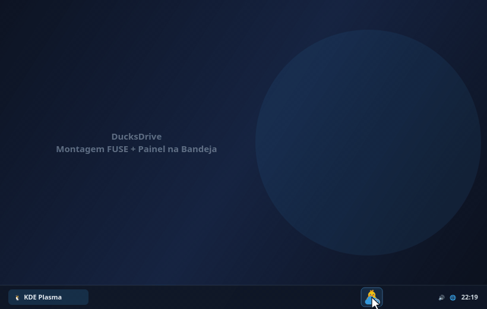
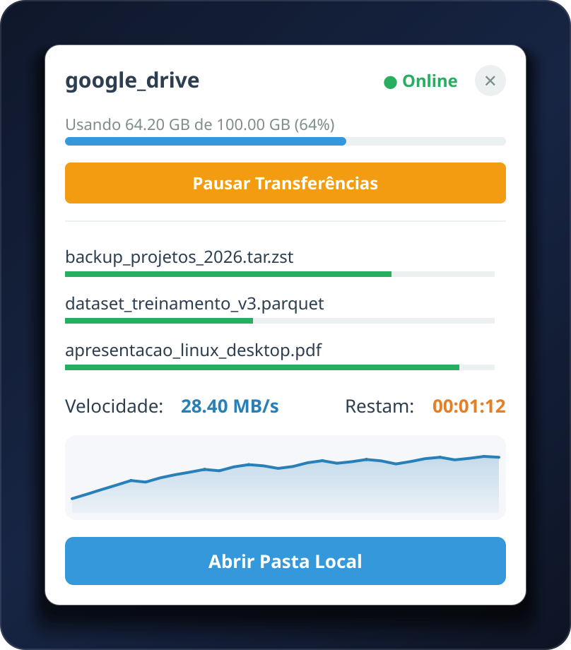
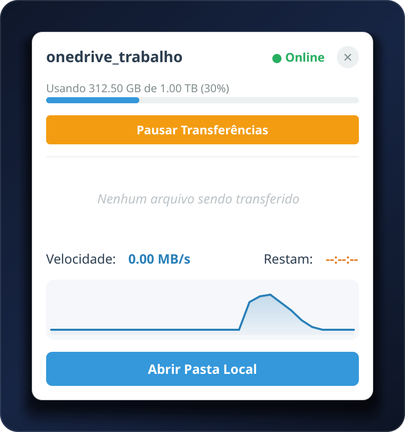
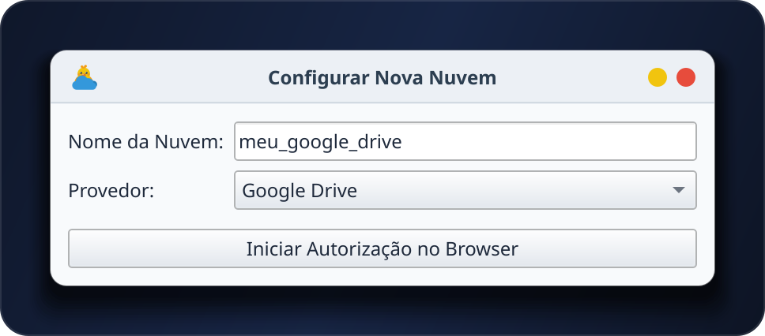
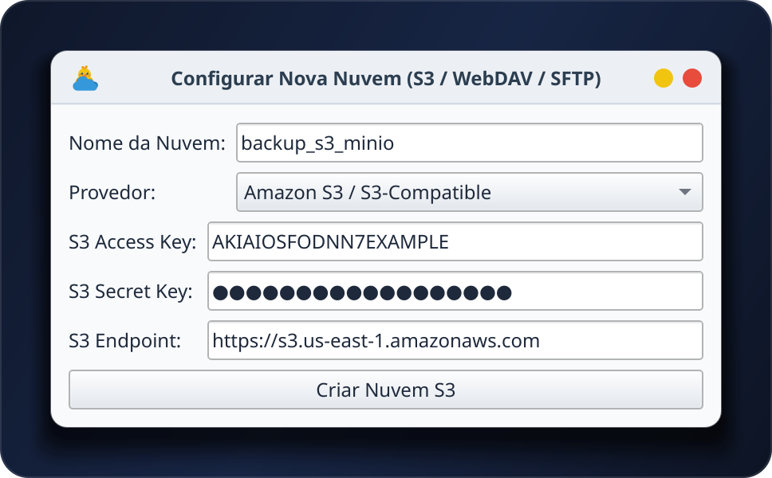
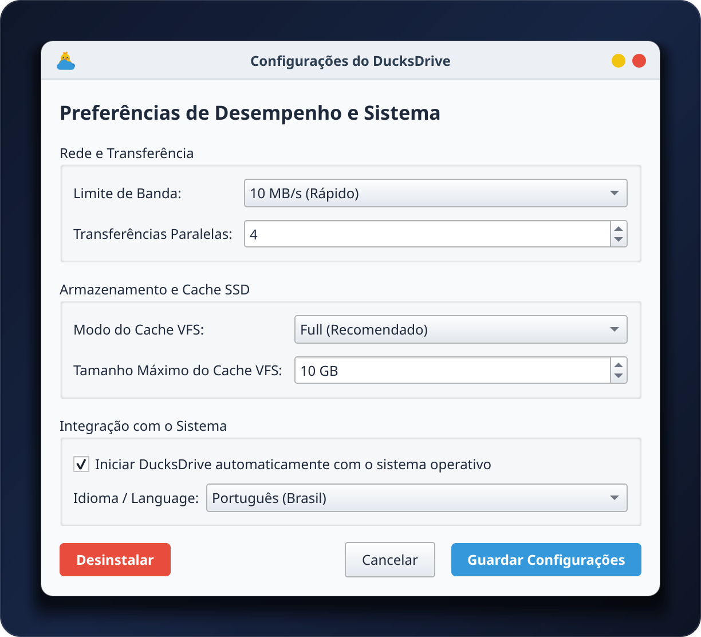

# DucksDrive


Interface gráfica em Python (PySide6/Qt) para montar e gerenciar nuvens e unidades de rede pelo rclone no Linux. A ideia é ter algo parecido com o cliente do Google Drive do Windows: ícone na bandeja, um painel com o andamento das transferências e a nuvem aparecendo como uma pasta normal no gerenciador de arquivos.

Compatível com KDE Plasma, GNOME, XFCE e outros ambientes.

[Página do projeto](https://patopatetico2-lab.github.io/ducksdrive/) • [Releases (AppImage)](https://github.com/Patopatetico2-lab/ducksdrive/releases)



## O que ele faz

Clicando no ícone da bandeja, abre um painel flutuante com o uso de espaço da nuvem (quota), um botão para pausar ou retomar os envios na hora e a lista de transferências ativas: barra de progresso por arquivo, velocidade em MB/s, tempo restante (HH:MM:SS) e um gráfico com o histórico de velocidade de transferência, desenhado com `QPainter`.

A nuvem é montada via FUSE em `~/CloudDrives/{nome_do_remoto}`. Depois de pedir a montagem, o app confere por até 10 segundos se ela realmente aconteceu, sem travar. Um `QTimer` fica de olho no processo do FUSE em segundo plano, e se ele cair do nada o estado do app é atualizado. Ao fechar, o app espera até 10 segundos para o cache terminar de ser gravado na nuvem.

Na barra lateral do Dolphin (KDE) e dos gerenciadores GTK (Nautilus, Thunar, Nemo) ele cria um atalho com o nome do remoto. No KDE, antes de mexer no arquivo de favoritos, o app salva uma cópia em `user-places.xbel.bak`.

Só uma instância roda por vez (`QLockFile`), para não dar conflito na porta do RC. Os logs ficam em `~/.local/share/ducksdrive/ducksdrive.log`, com rotação automática de até 5 MB (`RotatingFileHandler`).

 

## Como configurar uma nuvem

Pelo menu do ícone na bandeja, vá em **Gerenciar Nuvens → Adicionar Nova Nuvem...**. Dá para adicionar tanto serviços que fazem login pelo navegador (Google Drive, OneDrive, Dropbox, Box e pCloud) quanto servidores com credenciais diretas na janela (Amazon S3 / compatíveis como MinIO e Wasabi, Nextcloud / WebDAV, Mega, FTP e SFTP).

Depois de criada, é só escolher a nuvem no menu para montar.

 

## Configurações

Ficam em `~/.config/ducksdrive/config.json` e dá para mexer pela tela de configurações do app:

- `--bwlimit`: limite de banda, tipo `10M`, ou `off` para sem limite (aplicado em tempo real via API RC sem precisar desmontar). Ajuda a não saturar a rede nem travar jogo online.
- `--vfs-cache-mode` e `--vfs-cache-max-size`: modo do cache (`full`, `writes`, `minimal` ou `off`), quanto espaço do SSD o cache pode usar (ex: `10G`), medidor do uso atual no SSD e botão **Limpar Cache Agora**.
- `--transfers`: quantos arquivos são sincronizados ao mesmo tempo, tipo `4`.
- Idioma: Português (Brasil) ou Inglês (EUA), aplicado na hora sem precisar reiniciar.
- Tema do Painel: Automático (segue o modo escuro/claro do sistema), Escuro (`#202326`) ou Claro (`#ffffff`).
- Reconexão inteligente (`last_remote`): lembra a última nuvem conectada e monta ela automaticamente ao iniciar.
- Iniciar com o sistema (autostart): liga e desliga pelo mesmo menu.



## Instalação

### Arch Linux / CachyOS / Manjaro (Nativo via Pacman)
Instalação direta em 1 comando via Pacman:
```bash
curl -Lo /tmp/ducksdrive-1.0.6-1-any.pkg.tar.zst https://github.com/Patopatetico2-lab/ducksdrive/releases/download/v1.0.6/ducksdrive-1.0.6-1-any.pkg.tar.zst && sudo pacman -U /tmp/ducksdrive-1.0.6-1-any.pkg.tar.zst && rm -f /tmp/ducksdrive-1.0.6-1-any.pkg.tar.zst
```
Ou compilando direto do repositório com `makepkg`:
```bash
git clone https://github.com/Patopatetico2-lab/ducksdrive.git && cd ducksdrive && makepkg -si
```

### Debian / Ubuntu / Linux Mint / Zorin OS (Nativo via .deb)
Instalação direta em 1 comando via `apt`:
```bash
curl -Lo /tmp/ducksdrive_1.0.6-1_all.deb https://github.com/Patopatetico2-lab/ducksdrive/releases/download/v1.0.6/ducksdrive_1.0.6-1_all.deb && sudo apt install -y /tmp/ducksdrive_1.0.6-1_all.deb && rm -f /tmp/ducksdrive_1.0.6-1_all.deb
```

### Pelo script (instala no sistema)
```bash
git clone https://github.com/Patopatetico2-lab/ducksdrive.git
cd ducksdrive
chmod +x install.sh
./install.sh
```
O script detecta se a distro usa `apt` (Debian/Ubuntu), `pacman` (Arch), `dnf` (Fedora/RHEL) ou `zypper` (openSUSE), instala o `rclone` e o `fuse3`, cria um venv, instala o PySide6 e registra o atalho e o ícone do app.

### Pelo AppImage (portátil)
Você também pode baixar o `.AppImage` direto na aba de [Releases](https://github.com/Patopatetico2-lab/ducksdrive/releases) (ele já traz o binário do `rclone` junto) ou gerar um localmente rodando `./build_appimage.sh`.

## Desinstalação

Dá para desinstalar clicando no botão **Desinstalar** dentro da tela de configurações do próprio app (ele desmonta as nuvens, limpa os atalhos e apaga os arquivos), ou rodando o script na pasta do projeto:

```bash
./uninstall.sh
```

---

<details>
<summary>English summary</summary>

### About
**DucksDrive** is a free, open-source Python (PySide6/Qt6) desktop client and GUI for mounting and managing cloud drives via `rclone` and `FUSE3` on Linux — bringing the Windows Google Drive for Desktop and RaiDrive experience to Linux. Works on KDE Plasma, GNOME, XFCE, Cinnamon, and other desktop environments.

Designed as a modern, lightweight alternative to **Insync**, **RaiDrive**, **Rclone Browser**, and **RcloneTray** on Linux.

### Features
- Floating system tray panel with cloud storage quota, a 1-click pause/resume transfers button, per-file progress bars, transfer speed (MB/s), ETA, and a live speed history graph drawn with `QPainter`.
- Mounts remotes on demand in `~/CloudDrives/{remote_name}` and automatically adds sidebar shortcuts in **Dolphin (KDE)** (backing up `user-places.xbel.bak`), **Nautilus (GNOME)**, **Thunar (XFCE)**, and **Nemo (Cinnamon)**.
- Built-in setup dialog for OAuth clouds (**Google Drive**, **Microsoft OneDrive**, **Dropbox**, **Box**, **pCloud**) and direct-credential providers (**Amazon S3 / MinIO / Wasabi**, **Nextcloud / WebDAV**, **Mega**, **FTP**, **SFTP**).
- GUI settings for gamer-friendly bandwidth limiting (`--bwlimit`), SSD VFS cache control (`--vfs-cache-mode`, `--vfs-cache-max-size`), parallel transfers (`--transfers`), language (PT-BR / EN-US), and system autostart.

### Install
Run `./install.sh` (supports `apt`, `pacman`, `dnf`, `zypper`) or grab the portable `.AppImage` (with `rclone` bundled) from [Releases](https://github.com/Patopatetico2-lab/ducksdrive/releases).
</details>
