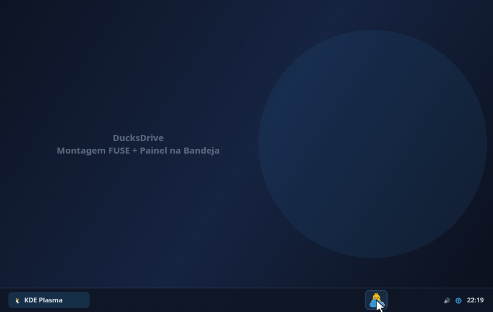
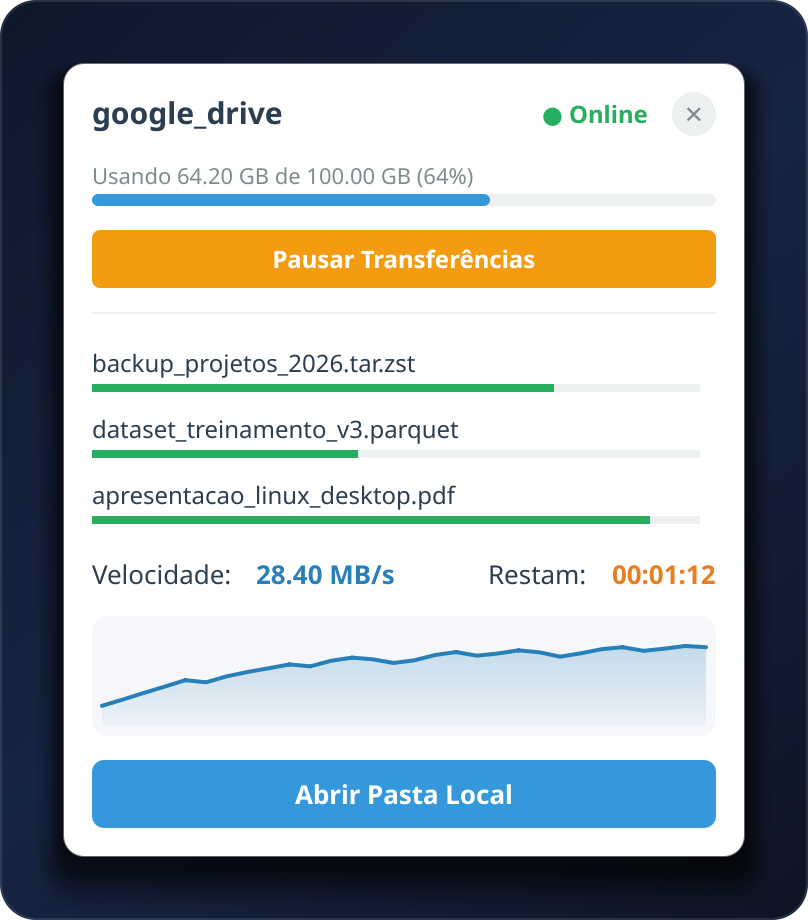
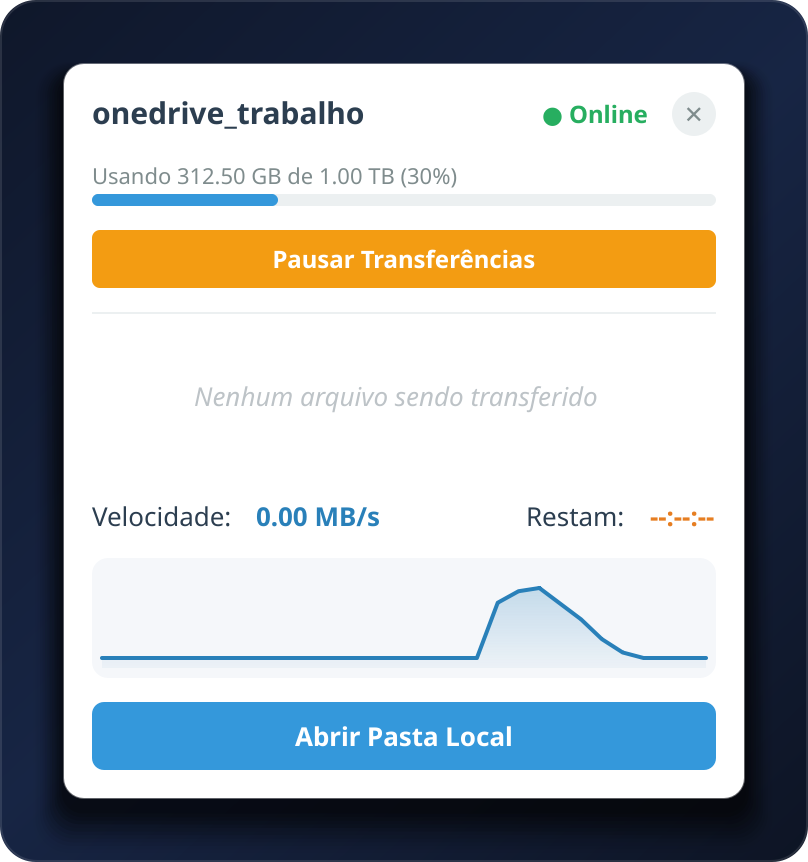
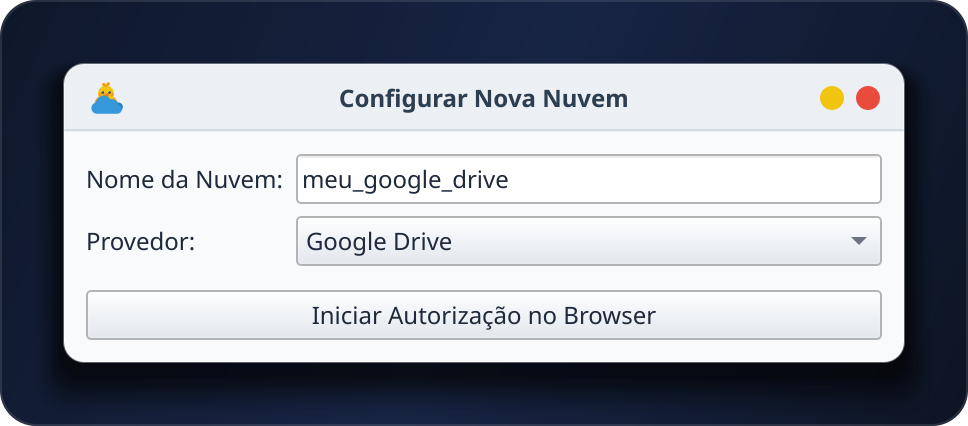
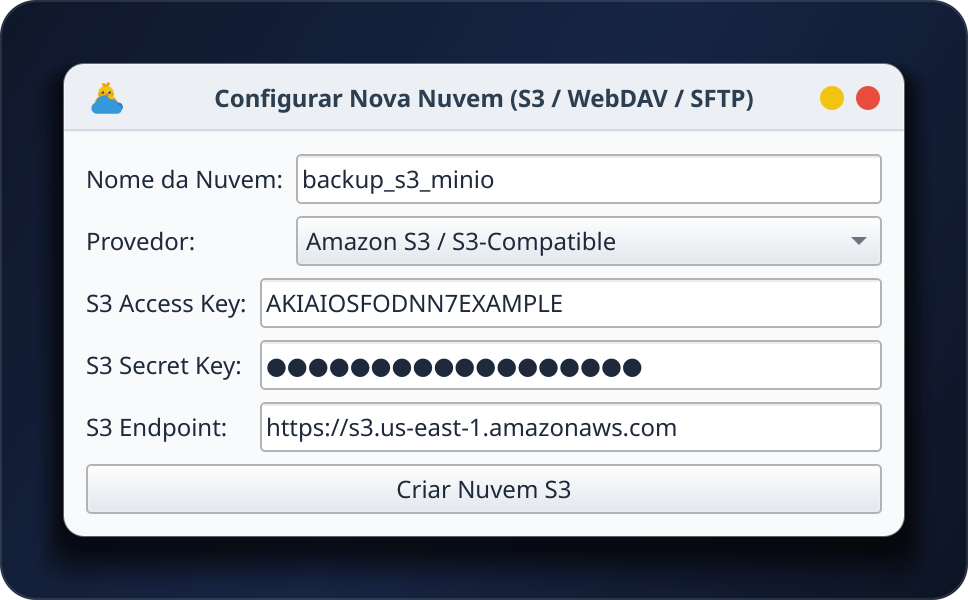
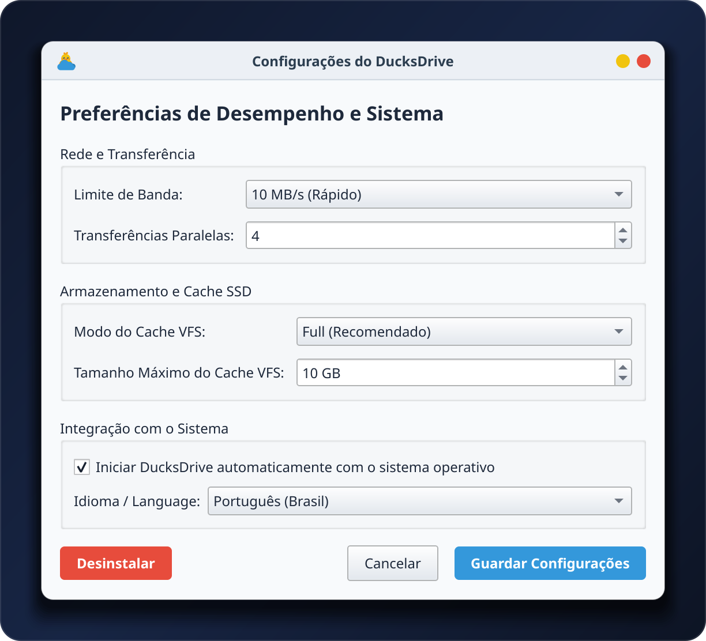

# DucksDrive — Cliente de Nuvem e Interface Gráfica Rclone para Linux

<p align="center">
  
</p>

<p align="center">
  <a href="https://patopatetico2-lab.github.io/ducksdrive/"></a>
  <a href="https://github.com/Patopatetico2-lab/ducksdrive/releases"></a>
  <a href="https://www.python.org/"></a>
  <a href="https://pypi.org/project/PySide6/"></a>
  <a href="LICENSE"></a>
</p>

> 🌐 **Site Oficial e Demonstração:** [https://patopatetico2-lab.github.io/ducksdrive/](https://patopatetico2-lab.github.io/ducksdrive/)  
> 📦 **Downloads e Pacotes Prontos (AppImage, Flatpak, .deb, Pacman):** [GitHub Releases](https://github.com/Patopatetico2-lab/ducksdrive/releases)

Interface gráfica em Python (PySide6/Qt6) para montar e gerenciar nuvens e unidades de rede pelo `rclone` e `FUSE3` no Linux. A experiência do cliente do Google Drive do Windows e do RaiDrive no Linux: ícone na bandeja do sistema, painel flutuante com telemetria em tempo real, controle de cache VFS e a nuvem integrada diretamente como uma pasta nativa no seu gerenciador de arquivos favorito.

Compatível com KDE Plasma, GNOME, XFCE, Cinnamon e outros ambientes de desktop Linux.

---

### Conteúdo
- [O que ele faz](#o-que-ele-faz)
- [Como configurar uma nuvem](#como-configurar-uma-nuvem)
- [Configurações](#configurações)
- [Arquitetura e Módulos do Projeto](#arquitetura-e-módulos-do-projeto)
- [Requisitos](#requisitos)
- [Instalação](#instalação)
- [Desinstalação](#desinstalação)
- [Solução de problemas](#solução-de-problemas)
- [English Summary](#english-summary)

---



## O que ele faz

Clicando no ícone da bandeja, abre um painel flutuante com o uso de espaço da nuvem (quota), um botão para pausar ou retomar os envios na hora e a lista de transferências ativas: barra de progresso por arquivo, velocidade em MB/s, tempo restante (HH:MM:SS) e um gráfico com o histórico de velocidade de transferência, desenhado com `QPainter`.

A nuvem é montada via FUSE em `~/CloudDrives/{nome_do_remoto}`. Depois de pedir a montagem, o app confere por até 30 segundos se ela realmente aconteceu, sem travar. Um `QTimer` fica de olho no processo do FUSE em segundo plano, e se ele cair do nada o estado do app é atualizado. Ao fechar, o app espera até 15 segundos para o cache terminar de ser gravado na nuvem.

Na barra lateral do Dolphin (KDE) e dos gerenciadores GTK (Nautilus, Thunar, Nemo) ele cria um atalho com o nome do remoto. No KDE, antes de mexer no arquivo de favoritos, o app salva uma cópia em `user-places.xbel.bak`.

Quando não tem nada sendo transferido, o painel mostra os **arquivos enviados recentemente**. Se o drive estiver desconectado, o mesmo botão de pausar vira **Conectar / Reconectar**. O painel pode ser arrastado para qualquer lugar da tela (funciona no Wayland e no X11).

Antes de desconectar, trocar de nuvem ou sair, o app verifica se ainda tem arquivo na fila de envio do cache VFS. Se tiver, ele avisa e oferece a opção **Aguardar e sair**, que só fecha depois que tudo subiu.

No submenu de cada nuvem também dá para:
- **Montar (Somente Leitura)**, para não correr o risco de apagar ou alterar nada sem querer;
- **Testar Conexão**, que diz se a nuvem está respondendo e, se o token OAuth tiver expirado, oferece **reautorizar pelo navegador** na hora;
- **Remover** a nuvem (o `rclone.conf` ganha um backup `.bak` antes).

E no menu principal tem **Atualizar Pastas**, que recarrega a listagem da nuvem (`vfs/refresh`) sem precisar desmontar.

Só uma instância roda por vez (`QLockFile`), para não dar conflito na porta do RC. Os logs ficam em `~/.local/share/ducksdrive/ducksdrive.log`, com rotação automática de até 5 MB (`RotatingFileHandler`). Cada montagem também gera um log do rclone (`rclone-{remoto}-{data}.log`) na mesma pasta, e só os 5 mais recentes são mantidos.

 

## Como configurar uma nuvem

Pelo menu do ícone na bandeja, vá em **Gerenciar Nuvens → Adicionar Nova Nuvem...**. Dá para adicionar tanto serviços que fazem login pelo navegador (Google Drive, OneDrive, Dropbox, Box e pCloud) quanto servidores com credenciais diretas na janela (Amazon S3 / compatíveis como MinIO e Wasabi, Nextcloud / WebDAV, Mega, FTP e SFTP).

Depois de criada, é só escolher a nuvem no menu para montar.

 

## Configurações

Ficam em `~/.config/ducksdrive/config.json` e dá para mexer pela tela de configurações do app:

- `--bwlimit`: limite de banda, tipo `10M`, ou `off` para sem limite (aplicado em tempo real via API RC sem precisar desmontar). Ajuda a não saturar a rede nem travar jogo online.
- `--vfs-cache-mode` e `--vfs-cache-max-size`: modo do cache (`full`, `writes`, `minimal` ou `off`), quanto espaço do SSD o cache pode usar (ex: `10G`), medidor do uso atual no SSD e botão **Limpar Cache Agora**.
- `--transfers`: quantos arquivos são sincronizados ao mesmo tempo, tipo `4`.
- Idioma: Português (Brasil) ou Inglês (EUA), aplicado na hora sem precisar reiniciar.
- Tema do Painel: Automático (segue o modo escuro/claro do sistema), Escuro (`#202326`) ou Claro (`#ffffff`).
- Reconexão inteligente (`last_remote`): lembra a última nuvem conectada e monta ela automaticamente ao iniciar.
- Iniciar com o sistema (autostart): liga e desliga pelo mesmo menu.



## Arquitetura e Módulos do Projeto

O DucksDrive é modular e orquestrado em Python puro com PySide6 (Qt6), dividindo as responsabilidades de forma desacoplada:

| Módulo / Arquivo | Responsabilidade Técnica |
|---|---|
| [`main.py`](main.py) | **Ponto de Entrada e Ciclo de Vida**: trava de instância única com `QLockFile`, checagem de ambiente desktop e bandeja do sistema, verificação de versão mínima do Rclone (`>= 1.63.0`) e captura de sinais do sistema operacional (`SIGINT`/`SIGTERM`) para encerramento gracioso. |
| [`rclone_daemon.py`](rclone_daemon.py) | **Daemon de Montagem FUSE e Ciclo de Vida do Drive Virtual**: gerencia o subprocesso de montagem em segundo plano via `rclone mount`, gera credenciais aleatórias em memória para a API RC, orquestra flags de cache VFS (`--vfs-cache-mode`, `--vfs-write-back`, etc.) e executa desmontagem segura com fallback dinâmico para `fusermount3` ou `fusermount`. |
| [`gui_tray.py`](gui_tray.py) | **Interface da Bandeja (System Tray)**: ícone da área de notificação (`QSystemTrayIcon`), menus contextuais dinâmicos, checagem preventiva de uploads pendentes antes de desmontar ou sair e diálogos de autenticação OAuth no navegador. |
| [`status_popup.py`](status_popup.py) | **Painel Flutuante de Telemetria**: janela frameless (`Qt.Tool`) compatível com Wayland e X11, medidor de quota de armazenamento, progresso individual de arquivos, botão pausar/retomar em 1 clique e gráfico histórico de velocidade desenhado nativamente com `QPainter`. |
| [`rclone_stats.py`](rclone_stats.py) | **Coleta de Estatísticas RC**: faz polling periódico dos endpoints `/core/stats` e `/core/transferred` da API RC, calculando métricas de taxa de transferência (MB/s), ETA e histórico recente de uploads. |
| [`rclone_config.py`](rclone_config.py) | **Gerenciador de Configuração do Rclone**: leitura direta do arquivo `rclone.conf`, criação assíncrona de remotos em background, teste de conectividade (`rclone about`) e reconexão automática de tokens OAuth expirados. |
| [`rclone_settings.py`](rclone_settings.py) | **Persistência de Preferências**: carregamento e gravação em `~/.config/ducksdrive/config.json`, detecção de paleta e modo escuro/claro do sistema (incluindo KDE Plasma 6 e GNOME) e sincronização do autostart. |
| [`settings_dialog.py`](settings_dialog.py) | **Janela de Configurações**: controle visual de limites de banda (`--bwlimit`), parâmetros de cache VFS em SSD, seleção de idioma em tempo de execução e rotina de desinstalação segura. |
| [`filemanager_integration.py`](filemanager_integration.py) | **Integração com Gerenciadores de Arquivos**: injeção atômica de atalhos na barra lateral do Dolphin (KDE `user-places.xbel` com backup de segurança `.bak`) e gerenciadores GTK (GNOME Nautilus, XFCE Thunar, Nemo). |
| [`i18n.py`](i18n.py) | **Internacionalização**: dicionário e função `tr()` para alternância instantânea entre Português (Brasil) e Inglês (EUA). |

## Requisitos

- Linux com **FUSE3** (`fuse3`)
- **rclone 1.63 ou mais novo** (o AppImage e o Flatpak já trazem o rclone embutido)
- Para os pacotes nativos e o script: **Python 3.10+** e **PySide6 6.6+**

## Instalação

### Arch Linux / CachyOS / Manjaro (Nativo via Pacman)
Instalação direta em 1 comando via Pacman:
```bash
curl -Lo /tmp/ducksdrive-1.0.8-1-any.pkg.tar.zst https://github.com/Patopatetico2-lab/ducksdrive/releases/download/v1.0.8/ducksdrive-1.0.8-1-any.pkg.tar.zst && sudo pacman -U /tmp/ducksdrive-1.0.8-1-any.pkg.tar.zst && rm -f /tmp/ducksdrive-1.0.8-1-any.pkg.tar.zst
```
Ou compilando direto do repositório com `makepkg`:
```bash
git clone https://github.com/Patopatetico2-lab/ducksdrive.git && cd ducksdrive && makepkg -si
```

### Debian / Ubuntu / Linux Mint / Zorin OS (Nativo via .deb)
Instalação direta em 1 comando via `apt`:
```bash
curl -Lo /tmp/ducksdrive_1.0.8-1_all.deb https://github.com/Patopatetico2-lab/ducksdrive/releases/download/v1.0.8/ducksdrive_1.0.8-1_all.deb && sudo apt install -y /tmp/ducksdrive_1.0.8-1_all.deb && rm -f /tmp/ducksdrive_1.0.8-1_all.deb
```

### Pelo script (instala no sistema)
```bash
git clone https://github.com/Patopatetico2-lab/ducksdrive.git
cd ducksdrive
chmod +x install.sh
./install.sh
```
O script detecta se a distro usa `apt` (Debian/Ubuntu), `pacman` (Arch), `dnf` (Fedora/RHEL) ou `zypper` (openSUSE), instala o `rclone` e o `fuse3`, cria um venv, instala o PySide6 e registra o atalho e o ícone do app.

### Pelo Flatpak
Baixe o `ducksdrive.flatpak` da aba de [Releases](https://github.com/Patopatetico2-lab/ducksdrive/releases) e instale (o rclone já vem junto; o runtime `org.kde.Platform 6.8` é baixado do Flathub automaticamente):
```bash
curl -Lo /tmp/ducksdrive.flatpak https://github.com/Patopatetico2-lab/ducksdrive/releases/download/v1.0.8/ducksdrive.flatpak && flatpak install --user -y /tmp/ducksdrive.flatpak && rm -f /tmp/ducksdrive.flatpak
```
> Para montar via FUSE e criar os atalhos no gerenciador de arquivos, o Flatpak precisa de acesso amplo ao sistema (`--filesystem=host` e `--device=all`).

### Pelo AppImage (portátil)
Baixe o `.AppImage` direto na aba de [Releases](https://github.com/Patopatetico2-lab/ducksdrive/releases) (ele já traz o binário do `rclone` junto), dê permissão de execução e rode:
```bash
curl -Lo DucksDrive-x86_64.AppImage https://github.com/Patopatetico2-lab/ducksdrive/releases/latest/download/DucksDrive-x86_64.AppImage
chmod +x DucksDrive-x86_64.AppImage
./DucksDrive-x86_64.AppImage
```
Ou gere um localmente rodando `./build_appimage.sh`.

## Desinstalação

O botão **Desinstalar** na tela de configurações do app desmonta as nuvens, limpa os atalhos e apaga as configurações. Ele pergunta antes se você quer apagar também as nuvens do rclone. Depois disso, remova o pacote de acordo com o jeito que você instalou:

| Instalado via | Como remover |
|---|---|
| pacman / makepkg | `sudo pacman -R ducksdrive` |
| .deb | `sudo apt remove ducksdrive` |
| Flatpak | `flatpak uninstall --delete-data com.github.patopatetico2.ducksdrive` |
| Script `install.sh` | `./uninstall.sh` na pasta do projeto |
| AppImage | o próprio botão **Desinstalar** já apaga o arquivo `.AppImage` |

## Solução de problemas

- **Logs:** `~/.local/share/ducksdrive/ducksdrive.log` (app) e `~/.local/share/ducksdrive/rclone-*.log` (rclone). Anexe esses arquivos ao abrir uma [issue](https://github.com/Patopatetico2-lab/ducksdrive/issues).
- **Pasta travada / "Transport endpoint is not connected":** feche o app e rode `fusermount3 -uz ~/CloudDrives/NOME_DA_NUVEM`.
- **Nuvem parou de conectar do nada:** use **Gerenciar Nuvens → (sua nuvem) → Testar Conexão**. Se o token OAuth tiver expirado, o app oferece reautorizar pelo navegador.

---

<details>
<summary>English summary</summary>

### About
**DucksDrive** is a free, open-source Python (PySide6/Qt6) desktop client and GUI for mounting and managing cloud drives via `rclone` and `FUSE3` on Linux — bringing the Windows Google Drive for Desktop and RaiDrive experience to Linux. Works on KDE Plasma, GNOME, XFCE, Cinnamon, and other desktop environments.

- 🌐 **Official Website:** [https://patopatetico2-lab.github.io/ducksdrive/](https://patopatetico2-lab.github.io/ducksdrive/)
- 📦 **Download Releases:** [GitHub Releases](https://github.com/Patopatetico2-lab/ducksdrive/releases)

Designed as a modern, lightweight alternative to **Insync**, **RaiDrive**, **Rclone Browser**, and **RcloneTray** on Linux.

### Features
- Floating system tray panel with cloud storage quota, a 1-click pause/resume transfers button, per-file progress bars, transfer speed (MB/s), ETA, and a live speed history graph drawn with `QPainter`.
- Mounts remotes on demand in `~/CloudDrives/{remote_name}` and automatically adds sidebar shortcuts in **Dolphin (KDE)** (backing up `user-places.xbel.bak`), **Nautilus (GNOME)**, **Thunar (XFCE)**, and **Nemo (Cinnamon)**.
- Built-in setup dialog for OAuth clouds (**Google Drive**, **Microsoft OneDrive**, **Dropbox**, **Box**, **pCloud**) and direct-credential providers (**Amazon S3 / MinIO / Wasabi**, **Nextcloud / WebDAV**, **Mega**, **FTP**, **SFTP**).
- GUI settings for gamer-friendly bandwidth limiting (`--bwlimit`, applied live via the RC API), SSD VFS cache control (`--vfs-cache-mode`, `--vfs-cache-max-size`) with a usage meter and 1-click cache cleaner, parallel transfers (`--transfers`), Light/Dark/Auto theme, language (PT-BR / EN-US), and system autostart.
- Recent files history, read-only mounts, connection test with 1-click OAuth re-authorization, folder refresh (`vfs/refresh`) without unmounting, and a pending-upload check that offers to **wait for uploads to finish** before disconnecting or quitting.

### Architecture & Project Structure
- [`main.py`](main.py): Application entrypoint, single-instance lock (`QLockFile`), tray availability checks, and signal handling.
- [`rclone_daemon.py`](rclone_daemon.py): Virtual drive lifecycle & FUSE mount daemon managing background `rclone mount` subprocesses, RC credentials, and VFS cache.
- [`gui_tray.py`](gui_tray.py): System tray icon, menus, connection tests, and OAuth browser flow.
- [`status_popup.py`](status_popup.py): Frameless telemetry panel with live speeds, quota bar, and rolling transfer history chart.
- [`rclone_stats.py`](rclone_stats.py): RC API polling, transfer telemetry parser, and ETA calculator.
- [`rclone_config.py`](rclone_config.py): Remote listing, configuration parser, and OAuth reconnect.
- [`rclone_settings.py`](rclone_settings.py): JSON preference manager and desktop dark/light mode detection.
- [`settings_dialog.py`](settings_dialog.py): Preferences dialog for bandwidth, VFS cache, and themes.
- [`filemanager_integration.py`](filemanager_integration.py): Sidebar bookmarks for KDE Dolphin and GTK file managers.
- [`i18n.py`](i18n.py): Lightweight internationalization engine (PT-BR / EN-US).

### Requirements
Linux with FUSE3 and rclone 1.63+ (bundled in the AppImage and Flatpak). Native packages and the install script need Python 3.10+ and PySide6 6.6+.

### Install
Grab the `.pkg.tar.zst` (Arch), `.deb` (Debian/Ubuntu), `.flatpak`, or the portable `.AppImage` (with `rclone` bundled) from [Releases](https://github.com/Patopatetico2-lab/ducksdrive/releases), or run `./install.sh` (supports `apt`, `pacman`, `dnf`, `zypper`).

### Troubleshooting
Logs live in `~/.local/share/ducksdrive/` (`ducksdrive.log` and `rclone-*.log`). If a mount gets stuck, quit the app and run `fusermount3 -uz ~/CloudDrives/REMOTE_NAME`.
</details>
